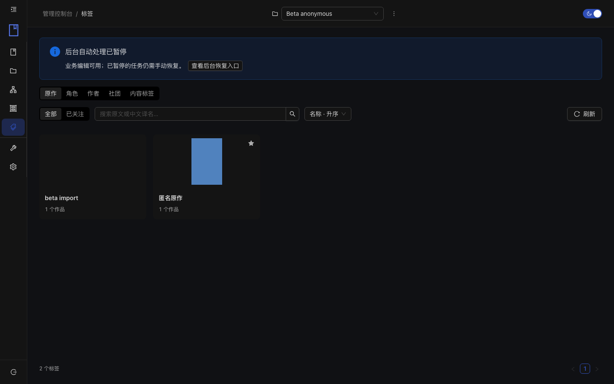
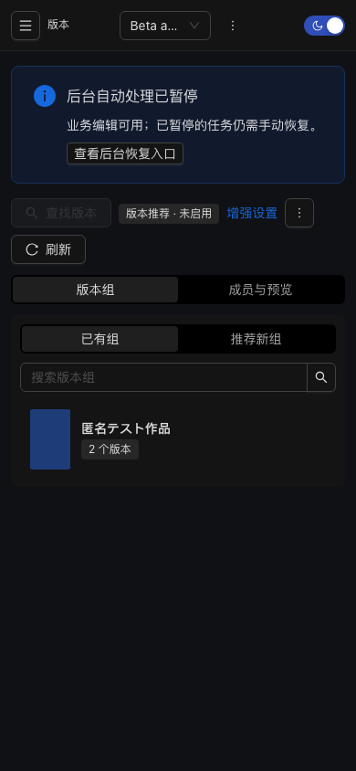

# NyaMangaServer

自托管漫画资料管理服务，使用 Go、SQLite 和 React，面向个人与小范围多账号使用。

将源漫画只读挂载到服务器，在浏览器中完成入库、元数据核对、版本归纳、系列整理和标签管理。**本项目目前是管理服务，不包含完整阅读器。**

> 本次测试版为 `v0.7.0-beta.2`。镜像和安装附件以 [Releases](https://github.com/XKLZ/NyaMangaServer/releases) 中实际发布的产物为准；源码可用不代表发行验证已经通过。

## 能做什么

- **书库与导入**：多书库、离线扫描、文件诊断，元数据、版本和系列分阶段人工审核。
- **资料整理**：原文标题优先，来源资料与人工覆盖分离，标签、分类、评分、本地与远端文件统计。
- **版本与系列**：以 Work 管理同一作品的 Edition；手动组成、加入、排序、撤销，以及可选的本地推荐。
- **标签管理**：原作、角色、作者、社团、内容标签；译名、原作与角色关系、主体图、背景图和关注。
- **多账号**：管理员和逐书库查看／编辑授权；账号独立收藏、隐藏、保存搜索与阅读状态。
- **客户端协议**：当前源码提供设备会话、作品查询、版本化页目录、原文件续传、离线清单和个人状态重放。[接入说明](docs/client-foundation.md)
- **维护**：数据健康检查、受控修复、分类存储清理、整实例备份和跨机器恢复。

版本／系列推荐默认关闭，启用需自行提供匹配的本地模型。中文标签译库可选，安装及更新由用户主动触发。扫描不自动联网，也不修改源漫画。

## 界面

以下是合成数据的测试界面，不包含私人书库。



<details><summary>查看移动端版本管理</summary>



</details>

## Docker 快速开始

首个镜像支持 **Linux AMD64**，容器只暴露 `9400`。宿主端口可以自选。需要 Docker、Compose v2 和 Python 3（仅用于生成安装配置）。

1. 从 [Releases](https://github.com/XKLZ/NyaMangaServer/releases) 下载对应版本安装包并解压。
2. 在 Docker 宿主机准备一个新的私有配置目录。修改下方地址与漫画目录；`--origin` 必须是浏览器实际访问的地址。

```sh
sudo python3 deploy/configure.py \
  --directory /srv/nyamangaserver \
  --origin http://192.168.1.3:19400 --port 19400 \
  --library /srv/comics

cd /srv/nyamangaserver
sudo docker compose pull
sudo docker compose up -d --wait
```

3. 打开 `http://192.168.1.3:19400/admin/`。在宿主机本地读取 `/srv/nyamangaserver/setup-token`，填入初始化页面并设置管理员密码。不要把初始化凭据发送到 Issue 或聊天记录。
4. 在“书库”登记已挂载目录，再点击“导入漫画”；联网获取元数据前按需配置站点与代理。

没有源漫画时省略 `--library`，之后再显式添加挂载与允许根。配置生成器不启动服务、不创建账号或数据库；重复执行相同参数不会重置秘密。

详细说明：[安装、目录权限与离线镜像](deploy/README.md) · [推荐运行环境](runtime/recommendations/README.md) · [备份与恢复](docs/backup-restore.md)

## 测试版边界

- 早期 AMD64 构建已在 Intel N5105／8 GB NAS 上完成匿名基础业务、标准备份恢复和短时资源观察；不等于本公开候选的远端 CI 或长期稳定性验收。
- 本次发布不承诺 ARM64 原生运行、真实推荐性能、千本规模压力或公网安全部署。真实浏览器扩展高亮仍需用户验证。
- 备份**不包含源漫画**，也不包含程序、虚拟环境和模型。包中包含认证资料与密钥且不加密，必须私有保管。
- 恢复要求匹配的应用版本、完整构建身份及迁移账本；请同时保存原镜像或配对程序。不能用任意新版本直接恢复旧开发包。
- SQLite 数据卷必须位于服务主机本地文件系统；不要放在 SMB／NFS。

完整范围与当前验证状态见[测试版说明](docs/releases/v0.7.0-beta.2.md)。

## 开发与文档

工具链：Go **1.27.0**、Node **24.19.0**、npm **11.17.0**。正式可选推荐环境固定 Python **3.12.0** 及平台依赖锁。

```sh
make install
make check-source
make build
make init-dev
make dev-api
make dev-web
```

仅在新的本地开发实例使用上述初始化流程。开发 API 为 `127.0.0.1:8080`，Vite 为 `127.0.0.1:5173/admin/`；不要在同一实例并行启动多个后端。

[文档导航](docs/README.md) · [开发环境](docs/development-environment.md) · [OpenAPI](api/openapi.yaml) · [贡献指南](CONTRIBUTING.md) · [安全报告](SECURITY.md)

## 许可证与致谢

项目自有源码按 [MIT](LICENSE) 许可发布。第三方依赖、可选模型及译库遵循各自许可证，见[第三方说明](THIRD_PARTY_NOTICES.md)。项目未附带漫画、模型权重、站点凭据或完整译库；请仅管理你有权使用的内容。
