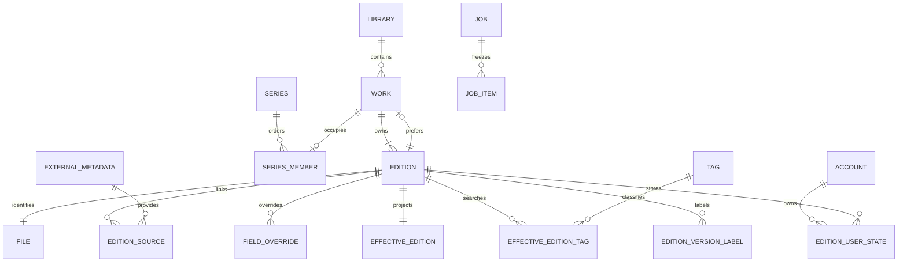
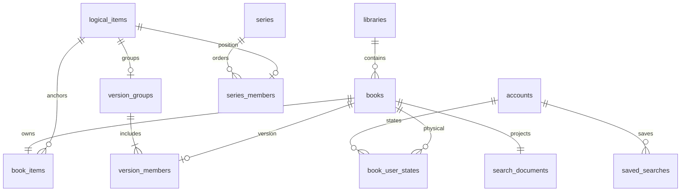

# 后端数据架构

## 导入批次与派生证据

012在主库新增批次、冻结成员、子任务请求／关联、候选、审核和方案关联；013保存系列证据代次及压缩块引用。候选在采纳前不修改共享正式来源。014仅增加批次阶段处置JSON，不新增表：明确跳过与子任务失败、逐成员归属审核分开保存；最新尝试控制关卡，失败历史不抹除。014阶段升级状态见[第二轮改进](import-round2.md)。详见[完整导入流程](import-workflow.md)。

现行能力和最近升级状态见[README](../README.md)。本文前半为存储职责与安全规则，后半按日期保留演进记录；其中旧schema、实例和重置叙述不作为新的操作授权。

本文确定存储职责、数据所有权和演进规则；详细领域不变量见 [领域规则](domain-rules.md)，关系约束见[Work／Edition模型](work-edition-model.md)，文件与扫描边界见[入库约定](ingestion.md)。目标实体和目录随功能建立，不因设计存在而提前建表或创建占位模块。

## 1. 存储现状与历史重置边界

001–006保持原校验和，007原位迁移旧ID和关系。旧EditionID等于原书籍ID；WorkID等于原逻辑条目ID；File使用EditionID作为一对一键。旧版本组ID→WorkID私有映射报告与升级快照同在`upgrade-snapshots`，权限0600，不保存标题或源路径。
封面是 `data/cache/covers/v1/<摘要前两位>/<摘要>.png`，键包含书籍 ID、内容版本和处理版本，当前限制 2GiB／10000 文件，采用 LRU。页面按需读取指定 ZIP 条目，没有持久化整本解压结果。`data/upgrade-snapshots/` 保存迁移前一致性快照；这些快照含认证摘要，不能当成可公开导出的业务备份。SQLite 的 WAL／SHM 由 SQLite 管理，运行中不能作为普通文件清理。

以下为已经完成的基础重构重置记录，当时实验数据获准丢弃；不适用于当前日常实例，也不授权再次执行：

| 材料 | 历史基础重构当时的处理（不适用当前升级） |
|---|---|
| 当前 Mac 开发库、WAL／SHM、封面缓存、升级快照 | 正常停服并确认实例退出后清理，不保留兼容转换副本 |
| 当前初始化凭据 | 清理后重新安全随机生成，仍为私有文件；重新初始化管理员 |
| 开发配置、允许根目录映射 | 保留；若新格式需要调整则显式更新，不丢弃 root_key 映射 |
| `.runtime/libraries/manual/` 的漫画原文件 | 保留、只读；通过重新添加书库和扫描建立新索引 |
| 历史阶段材料、自动测试材料及报告、工具缓存 | 保留，不作为新实例的自动恢复源 |
| Ubuntu 实例、镜像、容器及数据卷 | 暂不操作、不自动清理 |

重置仅限当前开发实例的生成数据及初始化凭据，不递归删除整个 `.runtime/` 或整个 `secrets/`，不停止其他项目进程。此前基础重构按明确授权实施重置；M3 不再次清库，保留现有账号、书库、索引、配置和源漫画。该历史交付实例当时等待用户初始化；当前已有账号和书库，升级沿用。

## 2. 存储职责与目标目录

采用一个 SQLite 主业务库，系列、作品、版本资料、人工编辑和未来阅读状态不拆成独立业务数据库。它们与书籍的修改需要同一事务。较大的二进制素材与派生索引在文件层独立管理。

```text
.runtime/dev/
├── config.json
├── vite-config.json
├── secrets/                  # 初始化凭据、provider-key 与 providers.enc
└── data/
    ├── app.sqlite            # 主业务数据源；WAL／SHM 由 SQLite 管理
    ├── app.lock              # 单实例使用数据目录的进程锁
    ├── assets/               # 人工素材、需要保留的导入附件
    ├── cache/
    │   ├── covers/           # 自动生成封面，规格版本＋摘要分片
    │   ├── tag-translations/ # 已实现：完整词库按 SHA256 存储
    │   └── pages/            # 后续按需生成的页面派生图
    ├── indexes/              # 当前推荐特征及后续派生索引
    ├── tmp/                  # 未提交文件和重建暂存
    └── upgrade-snapshots/    # 私有完整升级回退快照
```

封面、tag-translations、assets/covers 和推荐特征 indexes 已实施；cache/pages 随后续页面派生功能建立。`.runtime/cache/` 继续保存 Go／npm／Playwright 工具缓存，与应用图片缓存分开。源漫画位于 `.runtime/libraries/manual/` 或部署配置明确允许的独立根，不移入 data。

所有内部素材引用保存素材 ID、相对存储键、类型、长度和摘要；存储键由服务生成并限制在对应根内，不接受网页提供的任意服务器路径。摘要分片采用前两位十六进制目录，避免大目录；根目录搬迁不改变数据库引用。人工素材使用 SHA256 内容摘要校验，代表图 SHA1 继续仅用于外部查找，不充当书籍或素材的唯一业务身份。

| 类别 | 所有者与生命周期 | 删除／失效规则 |
|---|---|---|
| 主业务库 | 领域服务经仓储事务写入，长期保存 | 清缓存不能删业务记录；删除或修复须独立领域命令 |
| 已采纳来源与人工编辑 | 元数据服务，保留来源与人工劳动 | 来源刷新不覆盖人工值，不按 TTL 清掉已采纳来源 |
| 人工素材／导入附件 | 素材管理，数据库登记引用 | 参与业务备份；解除引用后经孤儿核对再清理 |
| 封面／页面缓存 | 图片派生服务，可重建 | 分开配额与淘汰，按输入和规格版本失效 |
| 向量索引 | 独立派生索引组件，可重建但可能昂贵 | 独立限额与重建命令，不加入图片 LRU |
| 临时文件 | 创建它的操作／任务 | 仅清理已结束或确认无活动拥有者的残留 |
| 任务及成员 | 任务服务，活动任务必须完整保留 | 终态明细按保留窗口归档／清理，保留摘要与错误统计 |
| 升级快照 | 迁移执行器，私有完整回退材料 | 按版本、数量和空间管理，不能删除唯一有效回退点 |

终态任务、临时文件和快照的数值保留策略在相应清理功能实施时配置并测试；本次不引入定时删除。图片初始预算沿用现有 2GiB／10000 文件，重构时将封面预算显式配置；页面预算在阅读阶段单独确定，不能共享封面 LRU。三万本规模的目标需要单独核验容量，不能把现有缓存条目上限当成书库容量上限。

## 3. 领域关系与字段所有权

当前核心关系如下；推荐特征登记另见schema8节，阅读与向量搜索尚未实现，不提前建表。Work非空、首选Edition属于自身以及Edition/File一对一由延迟外键和事务校验共同保证。



| 数据 | 写入责任与规则 |
|---|---|
| 文件路径、大小、时间、页数、带算法版本的查找 SHA1、文件状态 | 扫描服务维护；书籍 ID 稳定，源变化增加 content_revision |
| 文件名标题 | 文件索引的回退显示值；后续不再与人工标题或外部标题混用 |
| 外部原文、规范化字段、提供方身份、解析版本 | 元数据服务维护；以 provider＋external_id 标识来源，SHA1 查找缓存独立 |
| 来源关联与匹配依据 | 保存匹配方式及 matched_content_revision；内容变化使匹配待复核，保留已有来源 |
| 人工覆盖、人工标签与翻译 | 编辑服务维护；继承、主动清空、填写值可区分，输入限于受支持字段 |
| 有效标题／标签查询投影 | 从来源、人工覆盖和文件名回退派生，与来源选择和编辑同事务更新，可重建 |
| Work名称、首选版本、Edition归属、Series顺序、版本标签 | 组织服务维护；扫描和元数据刷新不改人工组织。版本标签归属Edition，移归/拆分不丢失 |
| 收藏、用户隐藏、阅读状态 | 用户状态／阅读服务维护，不由分组折叠推断或覆盖 |
| 任务状态、成员、检查点、执行代次 | 任务服务维护；结果和检查点同事务，旧代次不发布结果 |

外部原文必须有大小上限并去除凭据、认证头与敏感响应内容；普通有界响应保存在主库，必须保留的较大附件经素材层登记。人工字段采用受支持的类型与校验，不建立任意字段可写的万能属性系统。标签的人工整字段覆盖区分空列表和继承；机器翻译缓存不覆盖人工翻译。

Work是系列位置的稳定锚点，允许只有一个Edition。名称可人工填写或继承首选Edition的有效标题；来源、属性、标签、人工覆盖、素材与用户状态始终逐Edition保留。首选切换不改变Series位置；2→1不删除Work。移归、拆分、合并、回收和永久清除的具体规则见[领域规则](domain-rules.md)和[操作说明](work-edition-model.md)。
## 4. 文件、缓存与派生索引的一致性

### 图片与人工素材

- 自动封面键包含 book_id、content_revision、选图身份和处理规格版本（尺寸、格式及编码参数）；按摘要分片，不能只用代表 SHA1 判断新旧。页面派生键另外包含页身份。
- 文件先写入同文件系统临时位置并原子落盘，再提交数据库引用；失败留下的孤儿按引用和活动拥有者核对清理。多个实体共用素材时，不能因一个引用解除就删除共享文件。
- 缓存不参与业务提交原子性：封面写入失败时可提交有效文件索引并记录可诊断的派生错误，之后按需重建；数据库写入失败必须回滚，不能伪装为缓存降级。
- 源文件离线时，认证后的列表仍可展示已保存元数据和匹配当前版本的已有封面。缺失封面无法重建时返回明确占位状态；阅读源页仍需检查可用性和根路径边界。已实现当前版本离线封面回退；在线源文件大小或时间变化仍拒绝旧图，源页始终检查可用性。
- 源内容变化后不把旧缩略图当作新内容的有效封面；人工封面独立保存，按明确的人工选择语义处理，不因普通缓存淘汰丢失。

### 向量索引

只确定边界，不在本阶段引入向量依赖、模型服务或提前建立向量表。未来图像与标题向量可在 `data/indexes/` 使用各自的独立 SQLite 索引库，主库不依赖向量扩展。

索引项包含 book_id、输入指纹、模型标识／版本、预处理版本、维度和 generation；标题输入指纹根据有效标题生成，图像输入指纹根据实际选定图像与处理流程生成。不能只按书籍更新时间判断向量有效性，也不能跨不同模型空间直接比较距离。

完整重建先构造新 generation，校验后原子切换活动代次；失败继续使用旧的有效代次。跨主库和索引库不假定有外键或原子事务：工作器提交前、查询返回前都验证主库中实体及输入版本；可重试任务与对账清理负责收敛。索引缺失、过期或损坏不阻止认证、书库浏览和普通搜索。

## 5. 备份、重建与迁移

2026-11-03新增私有整实例备份／恢复，现行包包含密码摘要、vault配对、长期素材、现有派生缓存和完整业务状态，目标配置保持。下表“未来可导出业务备份”的脱敏策略属于旧普通业务导出设计，不适用于本专项。024、持久屏障、主库外激活日志和回退规则见[备份恢复](backup-restore.md)；不改变TreeC转换排除秘密的约定。

| 数据 | 私有升级快照 | 未来可导出业务备份 | 恢复／重建 |
|---|---|---|---|
| 主库业务关系、人工编辑、已采纳来源 | 完整保留 | 保留 | 校验后恢复 |
| 管理员密码摘要、会话摘要 | 完整保留，私有访问 | 在独立快照副本中移除，不修改活库 | 保留账号 ID，重新设密，旧会话失效 |
| 人工素材、导入附件 | 随对应版本的回退材料保留 | 保留文件、引用和摘要 | 校验引用与摘要，不能静默丢失 |
| 原始漫画 | 不包含 | 不包含 | 用户独立管理与根目录重映射 |
| 自动图片缓存、向量索引、查询投影 | 文件缓存／索引不要求保存；主库投影可随库存在 | 排除独立派生文件，库内投影可重建 | 按内容及模型版本重新生成 |
| 初始化／提供方凭据、加密密钥 | 不打包进数据库快照；由部署方单独保护 | 排除 | 独立重新配置 |
| 部署配置 | 记录必要的版本／布局信息 | 仅白名单可移植配置，不含秘密或宿主绝对路径 | 显式提供允许根映射 |

当前只实现数据库升级快照，没有人工素材功能和完整导出／恢复流程。未来引入不可重建素材时，升级回退须保持数据库和素材引用的同一版本；备份从一致性快照加受保护素材集合生成，必要时阻止相关写入。恢复先校验清单、摘要和关系，再激活，保留回退材料。不能复制活跃 WAL 主文件，也不能仅忽略 secrets 目录就宣称排除了同库认证信息。

开发期允许在后续重构中整理未发布建库基线，只包含已实施能力。新基线使用应用标识和基线身份区分旧实验库，迁移前核验身份、已应用版本和校验和；不认识、身份不符或校验失败时停止启动，不覆盖或自动创建替代空库。应用接口须明确旧库不可加载及需显式重置的原因，识别格式见第 8 节。

此次允许丢弃 M1／M2 实验数据，不扩大为 TreeC 数据可丢弃。TreeC 转换仍是独立工具，须保存来源 ID、人工有效值、原顺序和未支持字段附件，见 [迁移兼容性](migration-compatibility.md)。正式使用后的同基线升级保留版本化迁移、事务回滚、校验和和升级前一致性快照。

后续日常启动去除旧 M1 目录触发自动阻断／迁移的依赖；历史材料可保留，但不是启动或恢复来源。旧搬迁命令及 M1 启动检查已退役。

## 6. TreeC 源码对照

依据只读源码，不读取 TreeC 生产库、偏好、凭据或开发运行数据。以下路径均相对 TreeC 的 `Sources/TreeC/`，仅为参考定位，不建立编译依赖或要求相邻仓库存在。

| 参考源码 | 观察 | 本项目的取舍 |
|---|---|---|
| `Database/DatabaseManager.swift` | WAL 主业务库、迁移前一致性备份 | 沿用本地 SQLite 与迁移保护，业务关系保持同库事务 |
| `Services/CoverCacheService.swift` | Covers 下按摘要分片、原子写入；返回文件路径 | 借鉴分片与原子写入，引用改用相对键，增加处理规格版本 |
| `Database/DatabaseMigrator+TreeC.swift` | library_books 集中存放文件、展示、组织和部分用户状态；gallery_metadata 以 hash 为主键 | 拆清字段所有权，提供方身份与 SHA1 查找分离 |
| `Database/SQLiteGroupingRepository.swift` | 事务化主版本切换，先解除旧主版本；系列顺序维护在书籍字段 | 保留事务原则，使用逻辑条目稳定系列位置 |
| `Database/SQLiteCoverVectorRepository.swift` | 独立 CoverVectors.sqlite，跨库 best effort | 保持索引可重建，增加输入版本校验和对账边界 |
| `Database/SQLiteSemanticTitleVectorRepository.swift` | 模型 profile、generation 构建与活动代次切换 | 借鉴分代重建，不暴露半成品索引 |
| `Services/TagVisualAssetService.swift`、`Services/LibraryBackupService.swift` | 人工 TagAssets 与可重建文件分别管理 | 人工素材纳入业务备份，派生图和向量不纳入普通备份 |
| `Services/CoverFeaturePrintService.swift` | Apple Vision 图像特征提取 | 不直接移植到 Linux；模型与检索引擎另行选型 |

## 7. 实施顺序与验收

顺序为：设计固化 → 后端基础重构与重新建库 → 元数据及人工编辑 → 搜索、系列与版本组 → 阅读闭环 → 集中部署验收。模块边界为文件索引、元数据、组织、阅读、任务、素材与派生索引；仍是单进程模块化单体，HTTP 调用领域服务，仓储负责 SQL／事务，前端不自行决定修复与组织关系。

后端重构的退出条件包括：空库初始化、重复启动、旧实验库拒绝、保留配置与源漫画、重新扫描、缓存丢失后重建、缓存失败降级、取消立即重启、陈旧结果拒绝和重启持久化。数据库变化仍有迁移事务与失败回滚测试。元数据阶段覆盖人工值不被刷新覆盖，组织阶段覆盖主版本和顺序不变量，派生索引阶段覆盖输入变化与跨库延迟。

日常在 Mac 完成相关 Go 单元／仓储／HTTP／契约、race／vet、前端类型／构建和桌面／手机浏览器验证。暂停每轮 Docker 构建运行，不再例行复查 ROS 或环境；保留已有部署材料和历史验证记录，Ubuntu 不操作。交付注明当前提交是否经过容器验证，旧 M2 通过不代表未来版本通过。

本地能完成入库、元数据获取与人工编辑、搜索整理、阅读和重启保留数据后，集中处理 Linux／Docker 的构建、权限、持久化、恢复与停止行为。发布前仍须真实 Linux 部署验收，AMD64 运行与 NAS 性能由约定 NAS 实测。图像向量和 TreeC 转换单独排期，本轮不进入这些功能实现。

设计基线当时的文档验收：核对源码与当前状态、目标关系不变量、TreeC 保留语义、本地链接、内容一致性和 `git diff --check`；不把设计文档作为应用测试或重构已经完成的证据。


## 8. foundation-v1 存储实施

初始 SQL 合并为 001_foundation.sql，application_identity 保存唯一应用及基线身份，schema_migrations 继续保存迁移版本和 SHA256。身份先于 WAL／迁移变更检查；拒绝旧实验库、未知身份、未来版本和 checksum 错误。同基线升级继续一致性快照和事务回滚。内部 filename_title 与 HTTP title 分开。

封面预算可由 cover_cache.max_bytes／max_files 配置，缺省 2GiB／10000；缓存键包含书籍、内容版本、选图 SHA1、页身份和 320×480／nearest／PNG 处理版本。imagecache 管理分片、原子写入、LRU 与重启恢复；缓存失败记录 cover_cache_failed，保留有效页索引。ETag 是实际返回字节的 SHA256。

该存储增量当时通过make check/test/test-race，重置与最终启动的原始记录从清理前提交`f6e40af`追溯。该基础重构当时未运行容器，也未增加元数据、组织、阅读、向量或转换工具；M3 后续增量见下节。

## M3 历史落地关系

002_metadata.sql 不修改 001。external_metadata → book_sources → books 保存来源身份／链接；field_overrides → effective_books／effective_book_tags 保存人工所有权与查询投影。book_metadata_state 维护人工网址及选择版本，内容版本变化使来源待复核。标签译文区分人工与当前发行版，只有本地标签被物化。

通用 jobs／job_items 保留扫描数据，新增类型、父任务、冻结版本／输入、候选及尝试次数；job_resources 防止同书并行。events 与书籍／任务／翻译操作事务化，24 小时／10000 条上限。加密提供方文件位于 secrets，完整词库独立于图片 LRU；详细限额与文件失效规则见[元数据任务](metadata.md)。未来备份须保留人工译文和已采纳来源，不含 Cookie 或提供方密钥。

## M4 历史数据关系



新增 logical_items、book_items、version_groups、version_members、series、series_members、book_user_states、saved_searches、search_documents、search_tags、catalog_state。升级为已有书籍建立独立锚点，扫描新书同事务建立。组和系列不复用物理路径或SHA1作为身份。收藏／隐藏由账号状态仓储拥有，与元数据revision独立。

search_documents保存规范化有效两类标题和BLOB自然排序键，search_tags保存规范化原始标签；使用已固定x/text依赖，无新依赖。算法v1通过注册的确定性SQLite函数用于迁移与投影更新；后续算法变化须新增迁移重建投影，不能替换旧函数含义。

组织写入、投影、catalog_state和持久事件同事务提交。逻辑条目为组织锚点，组退化／解散保持原位置锚点；所有组严格唯一主版本，系列位置连续。query revision不受任务心跳或秘密修改影响。

目录、封面和秘密布局未变；没有为M4新建运行路径。新增组织、人工状态和保存搜索属于主业务数据，应随未来业务备份；搜索投影可重建但当前没有公开手工重建入口，不能直接删除表。完整升级快照包含同库认证摘要，继续私有保存。阅读、素材与向量模块仍未建表或目录。

## 管理台 schema4 增量所有权

本阶段继续foundation-v1，只新增迁移，不改001/002/003。书籍和书库的停用/回收站状态与个人隐藏独立；扫描排除具有持久身份，永久清除不意味再次扫描自动纳入。维护计划固定输入与目标版本，执行与检查点持久化，重复执行请求返回同一任务。

封面选择有独立版本，不改变代表SHA1与内容版本。归档选页绑定内容版本，变化后明确失效；人工上传登记为长期素材，保存相对键、摘要和引用，派生缩略图才进入封面缓存。素材原子落盘后提交引用，失败孤儿只在核对后清理。

来源预览保存有界规范化结果与目标版本，30分钟有效，确认前不替换已采纳来源；解绑保留人工覆盖，共享来源引用不能被其他书籍操作破坏。维护清理保护引用素材、活动资源和必要升级回退点。完整可导出备份仍单独规划。实际实现及验证见[管理台说明](admin-console.md)与[验证记录](admin-console-verification.md)。

004_administration.sql 新增 scan_exclusions、cover_selections、assets、maintenance_plans、source_previews、maintenance_blocks；扩展 jobs 类型并原样保留旧任务和检查点。封面素材引用通过服务事务校验，清理重新核对引用及文件指纹；来源预览失败不提前改人工 URL。重复物化同一译文不增加 revision，避免启动产生虚假编辑冲突。

## schema5 属性与词库派生索引

005新增effective_book_properties/effective_book_languages、projection_state、dictionary_generations/dictionary_entries/dictionary_state，详见[专项契约](properties-tag-suggestions.md)。属性人工值仍归field_overrides，不改变来源原文/原标签；有效语言独立有序关系，不以首个来源语言替代全部语言。

属性投影可以重建，但不能手工删除表后继续服务；启动检查投影版本/检查点，完成前不接收请求或恢复工作器。纯回填不改变书籍编辑版本。完整词库SQL表同库但所有权独立于业务tags，不为未使用词条创建标签；当前/上一完整/当前构建代次受保护，清理只淘汰派生代次。原始纯文本词库仍位于cache/tag-translations，人工翻译独立保留。

schema升级事务与Go属性回填分阶段：结构失败回滚；回填失败保留schema5检查点停止启动，同版本可继续。有效SQL词库无需原始缓存，缺失/损坏仅影响词库联想；不新增indexes目录或外部引擎。既有私有升级快照包含完整数据库及同库认证信息；未来业务导出应排除可重建词库索引，不能排除人工覆盖/人工翻译。

## 结构化目录与版本标签补充（2026-10-16）

006升级与[页面目录、内容页摘要及版本标签](archive-manifest.md)保持一致：页面目录属于有界归档会话缓存，不进入主业务库；book_pages仅存在于历史schema。选页通过归档条目身份保留，自动封面键与查找摘要解耦。查找摘要保存算法版本，采用第8页/短本第一页策略，不能当文件身份。多版本标签为有序成员关系，不反写语言/颜色属性。现有词库和有效标签关系不在本轮变更范围。

## 11. schema7：Work／Edition／File（2026-10-17）

007在同一受控事务内迁移父子外键、文件字段和标签。`files`拥有路径、文件名回退标题、大小、时间、页数、摘要/算法、内容版本、状态与索引时间；`editions`只保存身份、Work归属、资料编辑/组织revision和回收状态。任务持久JSON中的旧book_ids及资源键仍可恢复，ID、检查点、代次和暂停状态不因重命名丢失。封面键继续使用原稳定ID与内容版本，不重扫、不重算、不批量生成缓存。

上文M4/管理台/schema5/6章节为历史演进记录，不能用于恢复旧运行时组织模型。007后的有效规则以本文当前关系图和Work专项说明为准。原位升级失败整体回滚，首次升级前应用创建一致性私有快照；不直接运行外部sqlite命令迁移。

## 12. schema8：同作品推荐持久边界

008在既有任务体系新增`work_recommendation`，保留原任务ID、输入、检查点和执行代次。推荐不会自动改变Series／Work；采纳经规范组织预览与CAS，组织变换和反馈同一事务提交。收藏等无关状态不使候选失效，相关Edition输入或目标Work成员变化则拒绝旧建议。

| 数据 | 所有权及保留 |
|---|---|
| recommendation_batches | 冻结同库输入池、成员结果摘要、准备检查点与任务资源差值；任务级持久记录 |
| work_recommendations | 有界最终top20、输入摘要、支持版本与解释；实体删除后保留冻结ID／结果 |
| recommendation_feedback | 用户四类关系判断、备注、标签建议反馈和采纳结果；不是可重建向量 |
| recommendation_misses | 用户补录、当时查询／目标快照；不把补录数量当全库真实召回 |
| recommendation_features | 模型／预处理／输入及特征摘要登记；向量本体在`data/indexes/recommendations/features`，可重建且不参与封面LRU |
| recommendation_materials | 明确授权快照的原始封面输入，引用长期assets；不能按缓存淘汰 |

特征文件按输入指纹原子保存，失败不阻断普通管理；模型缺失仅使推荐不可用。建议、用户反馈和素材引用不能与派生向量一并清除。008重建任务类型约束时恢复全部外键及通知；所有待应用迁移提交前检查外键。私有升级快照仍含认证信息，不能作为公开导出。

当前隔离试用只导入授权白名单和封面副本，所有Work初始单版本、File缺源，来源归属标为`legacy_unknown`。这不是正式TreeC转换，账号、旧组织、旧任务和生产凭据不导入；正式开发实例保持原样。实际状态及资源口径见[试用说明](work-recommendation-pilot.md)。


## 13. schema9：全库发现与整理决策

009新增work_discovery_runs、work_pair_blocks、work_pair_evidence、work_proposals、work_proposal_members、work_proposal_decisions。配对证据与检查点为任务派生数据；方案和忽略／采纳／撤销快照独立保留，job_id可空，不阻断历史任务清理。实体ID与有界冻结内容保留历史解释，不用历史外键阻断源Work删除。

## 14. schema10：真实Work的系列发现

010扩展持久任务类型，新增series_discovery_runs、series_pair_rows、series_proposals、series_proposal_members、series_pending_works及series_proposal_decisions。冻结Work划分、Edition有效题名及标签、既有Series版本；MiniLM向量/逐行召回证据和检查点属于可重建任务输入。方案状态、忽略及采纳/撤销快照属于用户整理历史，不能按向量缓存淘汰。

方案成员按Work存储，不将多个Edition变成多个系列位置。Series修改沿用同库组织事务与CAS；resolve只改变方案，accept与决策同事务。Undo只恢复相关Series关系，不恢复Edition资料。后台证据重验保留无关草稿及revision，输入发生变化则停止并提示重新查找。方案分页及成员分页由SQL执行，任务历史清理暂保护仍被系列方案引用的任务。详见[接口、边界及验收](series-recommendation-pilot.md)。

## 15. schema11：版本标签所有权与可复用发现证据

人工标签继续保存在edition_version_labels；edition_label_policy标识legacy/auto/manual，edition_automatic_labels只保存自动预设。历史非空值保留manual，旧空值不因升级生成。组织成员变化和有效属性更新在原事务维护已激活的自动值；人工空数组与自定义字符串受到保护，恢复自动为显式操作。公开成员DTO合并来源，内部组织快照不混入自动值。

特征登记discovery_feature_inputs和任务输入discovery_run_features独立于业务组织。完整配对结果继续以压缩行块加有界推荐边存储，不逐条保存大量未命中关系；运行任务持有旧基线引用，完成复制后输出独立检查点。版本／输入不匹配或覆盖缺失时计算相应配对，不能把没有记录当作负例。首次新版查找需建立基线，后续复用；组织、主版本及标签不属于匹配输入。细节、限制及保留审计见[版本管理](version-management.md)。


## 系列方案身份与全局反馈（015）

匹配键与存储键分离；方案作用域为global或import:批次ID。新记录按作用域生成唯一存储键，旧键／ID／决定／快照不重写。采纳和撤销快照归具体方案；跨作用域的忽略／恢复由独立series_match_feedback保存，不复用组织快照。015新增两列、一个反馈表和作用域唯一索引，主库78表，不增加外部组件；有效缓存、模型和匹配输入不变。迁移及验证见[系列发布修复](series-publication-fix.md)。

## 导入来源查询的所有权（016）

source_searches／source_search_results保存用户发起查询和待比较快照，source_search_requests关联幂等的metadata_search任务。查询资料有界保存，属于审核输入，不写入已采纳的external_metadata或人工覆盖。选用后复制为import_candidates，随后仍通过原审核事务采纳；共享来源及投影不得在比较阶段生效。冻结文件／摘要／来源选择身份并校验工作器代次；重启可继续，批次取消同时失效查询IO。本轮不自动清理历史查询。详见[契约及验证](import-source-search.md)。


## 017 标签目录与原作／角色关系

新增 tag_relation_projection（规则、500条批次检查点及关系世代）、tag_character_evidence（单原作原始证据）、parody_character_decisions（全局人工决定与CAS墓碑）、edition_character_suppressions（Edition级自动否决及墓碑）。来源／人工标签仍归有效 Edition 投影，不将关系决定改写成元数据标签，也不改变 Work／Series 或推荐输入。

有效标签 INSERT／DELETE／UPDATE 触发器在原事务重新计算该 Edition 单原作证据，覆盖共享来源逐本刷新、人工覆盖及解绑。证据可以保留回收材料的可重建行，查询按当前库、回收和停用资格过滤；恢复即时重新生效，永久删除级联清理证据与该书否决。全局人工决定独立保留。启动先迁移并快照，再离线分批回填；失败不能启动HTTP或工作器，checkpoint与批次原子提交，重启续做。

## 标签关联Work的只读摘要（2026-10-28）

`tag-catalog/{id}/works`不新增存储或迁移：先按有效Edition标签限定当前库，再按Work去重、查询、排序、计数和分页；显示名继续人工名称／首选继承，封面代表独立在非回收成员中选择。Series和封面身份／revision在同一读事务批量返回，不查询归档或把首选元数据复制成Work资料。新接口独立快照补充库内封面revision世代，旧接口／017均不改。后续复用现有Work概览、分页成员及选择后的Edition详情，具体字段、边界和匿名验证见[标签管理](tag-management.md)。日常实例与前端更新由主对话另行安排。

## schema18标签图片

## schema19全局可选增强

019新增enhancement_revision、enhancement_settings、enhancement_transitions、import_enhancements；设置跨书库共享，配置CAS与组织／元数据编辑revision独立。关闭的任务暂停与代次提升、配置封锁、影响指纹复查同事务；发布和采纳仍必须事务门禁。待完成切换持久化，启动恢复只收尾原操作，不恢复暂停任务。导入新批次冻结两个推荐标志，旧批次按原语义。译库关闭屏蔽派生读取并保留全部人工与缓存数据。详见[增强设置](enhancements.md)。

## schema20标签关注

020新增tag_follows（account／tag复合主键、followed与revision墓碑）和tag_follow_epochs（每账号单调世代），events新增可空owner_account_id。原事件全部为NULL全局范围；新关注写入和私有事件同事务。读快照只纳入当前账号身份和其epoch，不抬升全局目录或人工编辑CAS。目录SQL筛选后统计／分页，摘要单次批量补齐；建议按实际tagID加入个人排序。SSE在SQL分页前过滤owner，游标与retention按整个保留日志判定真实断档。账号单例约束保持。见[标签关注](tag-follows.md)。

## schema21本地画廊高亮

021新增gallery_highlight_settings（默认off）及gallery_highlight_connections（account外键、名称、摘要、auth_revision、到期／撤销及独立CAS）。既有enhancement_settings定义与transition外键不变，独立单行设置通过原全局revision投影为第四feature，切换不进入任务／模型／译库生命周期。正式gid查询从external_metadata的provider／external_id唯一索引进入，再用edition_sources(metadata_id,edition_id)索引，SQL同readtx聚合启用未回收库中的未回收Edition，包含隐藏，不查候选或真实文件。query_version按实际请求／输出摘要，不推进目录revision。授权发布点和完整协议见[本地画廊高亮](local-gallery-highlight.md)。

## schema22高亮长期连接

## schema23数据健康与受控维护


## schema24整实例备份与恢复

024新增instance_operations、instance_state、instance_root_links三表，共106表，001–023原字节和账本保持。Operation持久保存幂等身份、阶段、revision及稳定失败码；instance_state区分短期业务写屏障、持久后台静止与整实例回退使用的业务写入世代；root_links保存目标配置允许根的显式关联及未关联状态。源漫画身份和内容版本不因跨机器stat映射而重算。

一致性SQLite快照与vault／应用文件固定为独立副本后解除业务写屏障，再打ZIP64包；后台任务保持暂停。恢复暂存与主库外激活日志位于instance-recovery，正常启动取得实例锁后、普通迁移之前分步安装并落盘；不在线替换已打开的主库，不假设Docker卷根能整体重命名。恢复与回退材料纳入存储统计、引用保护和空间预检，备份排除旧包及旧恢复暂存以避免递归。完整身份、边界和当前实际结果见[备份恢复](backup-restore.md)。

## 多账号与阅读（025／026源码）

accounts保留原身份／摘要／auth_revision五列，历史槽位1仅定位原管理员；account_profiles保存用户名、全局角色、启用／强制改密和ACL世代，account_library_grants保存逐库viewer/editor，审计不含密码。初始化及快照身份检查验证完整账号集合，不要求账号总数为1。jobs、import_batches、周期扫描及增强transition持久保存发起身份；后台不能用无身份context绕过权限。

HTTP赋予服务端Actor；领域服务及仓储分别负责入口权限和事务中的实时检查。固定关系范围在计数分页前限定读；写连接绑定同一事务的Actor，TEMP触发器逐表默认拒绝，并检查UPDATE旧新归属。全局维护／凭据及标签人工写由服务与HTTP双重门禁。完整清单及具体边界见[数据兼容](data-compatibility.md)和[路由矩阵](authorization-route-matrix.md)。